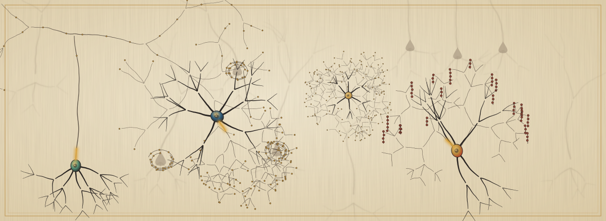

<div align="center">

<a href="https://annemi.studio">
  <picture>
    <source media="(prefers-color-scheme: dark)" srcset="assets/banner-dark.svg">
    
  </picture>
</a>

<br/>

[](https://annemi.studio) &nbsp;[](mailto:annemi.li@icahn.mssm.edu) &nbsp;[](https://www.linkedin.com/in/siyi-l-03a2a7380/)

<sub><i>And ne forhtedon ná &nbsp;·&nbsp; Ripple is a transient hippocampal oscillation.</i></sub>

</div>

<picture>
  <source media="(prefers-color-scheme: dark)" srcset="assets/divider-dark.svg">
  
</picture>

### 壹 &nbsp;·&nbsp; 关于 &nbsp;<sub>About</sub>

Grad student at CACT, Mount Sinai — DBS evoked potentials in OCD & depression. More at [annemi.studio](https://annemi.studio).

<picture>
  <source media="(prefers-color-scheme: dark)" srcset="assets/divider-dark.svg">
  
</picture>

### 贰 &nbsp;·&nbsp; 研究 &nbsp;<sub>Research</sub>

```text
  ongoing    DBS evoked potentials in OCD & depression ........... CACT · Mount Sinai
  writing    Panic ⇄ dissociation as dynamical state transitions ......... theory MS
  live       Before The Thought Arrives — 3D brain × EEG × emotion ........ Three.js
  in prep    Double integrating sphere + IAD on tissue phantoms ............ optics
  done       DeepLabCut + SimBA behavior quantification pipeline ......... behavior
  done       Trait anxiety & acute trauma in mouse defensive behavior ...... poster
  done       P.I.P. — ESP32 colorimetric glucose biosensor (capstone) ... hardware
  done       Mn removal from potable water w/ activated biomass ...... env. eng.
  done       Ogden / Mooney–Rivlin hyperelastic modeling ............. mechanics
```

> *Curiosity is not enough; you need to have some concerns and, even better, a bit of anger.* — 项飙 Biao Xiang

<picture>
  <source media="(prefers-color-scheme: dark)" srcset="assets/divider-dark.svg">
  
</picture>

### 叁 &nbsp;·&nbsp; 藏 &nbsp;<sub>What Lives Here</sub>

| Repo | |
|:--|:--|
| [**before-the-thought-arrives**](https://github.com/AnnemiL-experimental/before-the-thought-arrives) | EEG bands & emotional states mapped onto a 3D brain — [live](https://before-the-thought-arrives.annemi.studio/) |
| [**AnnemiL-experimental.github.io**](https://github.com/AnnemiL-experimental/AnnemiL-experimental.github.io) | *Between the Frames* — personal site — [annemi.studio](https://annemi.studio) |
| [**mood-cocktail**](https://github.com/AnnemiL-experimental/mood-cocktail) | 今天整点儿啥 — type a mood, get a cocktail — [try it](https://cocktail.annemi.studio) |
| [**Uniaxial-Characterization-…**](https://github.com/AnnemiL-experimental/Uniaxial-Characterization-and-Hyperelastic-Modeling-of-Soft-Materials) | Hyperelastic (Ogden) modeling of soft elastomers, experiment → fit |
| [**bioinstrumentation-presentations**](https://github.com/AnnemiL-experimental/bioinstrumentation-presentations) | Biopotentials & biosensors |
| [**my-philosophy**](https://github.com/AnnemiL-experimental/my-philosophy) | Essays on system dynamics, mind, and what resists explanation |
| [**jiuzhou**](https://github.com/AnnemiL-experimental/jiuzhou) | 九州志 — world-building archive |
| [**slavic-mythology**](https://github.com/AnnemiL-experimental/slavic-mythology) | 斯拉夫神话资料集 |
| [**humanities-ebooks**](https://github.com/AnnemiL-experimental/humanities-ebooks) | sociology · aesthetics · psychology |

<picture>
  <source media="(prefers-color-scheme: dark)" srcset="assets/divider-dark.svg">
  
</picture>

### 肆 &nbsp;·&nbsp; 器 &nbsp;<sub>Toolkit</sub>

<p>


<br/>


<br/>


</p>

<details>
<summary><b>Bench & fab</b> &nbsp;<sub>实验台</sub></summary>

```
PEDOT:PSS flexible electrodes  ·  PDMS casting  ·  tissue-mimicking phantoms
TiO₂ nanoparticle dispersion   ·  Kapton–FEP molds  ·  non-photolithographic patterning
TIA front-ends (MCP6002 + BPW34)  ·  BET surface analysis  ·  TGA  ·  pyrolysis
```

</details>

<picture>
  <source media="(prefers-color-scheme: dark)" srcset="assets/divider-dark.svg">
  
</picture>

### 伍 &nbsp;·&nbsp; 杂 &nbsp;<sub>Misc</sub>

<table>
<tr>
<td valign="top" width="50%">

**常听** &nbsp;<sub>On repeat</sub><br/>
Pink Floyd · 腰 · Placebo · 草东没有派对 · 王菲 · 陈粒 · 水仙斗活佛<br/>
<sub>punk · indie · psych rock · dream pop</sub>

**语言** &nbsp;<sub>Languages</sub><br/>
普通话 `native` · English `fluent` · 日本語 `中级` · Español `中级` · Deutsch `学习中`

</td>
<td valign="top" width="50%">

**站内小物** &nbsp;<sub>On the site</sub><br/>
[赛博算命 · Cyber Fortune](https://annemi.studio/cyber-fortune.html) — Disco Elysium-style divination<br/>
[留言板 · Guestbook](https://annemi.studio/guestbook.html) — say hi<br/>
[今天整点儿啥](https://cocktail.annemi.studio) — mood → cocktail

**从前** &nbsp;<sub>Before all this</sub><br/>
Community organizer 2020–22: mental-health programs, peer support & creative workshops across 10+ provinces in China.

</td>
</tr>
</table>

<picture>
  <source media="(prefers-color-scheme: dark)" srcset="assets/divider-dark.svg">
  
</picture>

<div align="center">
<i>愿你有苍老却无畏的样子</i><br/>
<i>永有金子般明亮的放肆</i><br/>
<i>永不回避命运对灵魂的逼视</i><br/>
<i>如果有一天我先你而逝</i>
</div>
